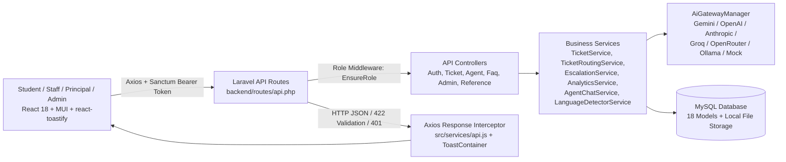

# સહાય (Sahay) — Hackathon Master Guide (ગુજરાતીમાં સંપૂર્ણ માર્ગદર્શિકા)

**AI-Powered Student Support & Query Management System**  
**Seva First Innovation Challenge 2026 · Government of Gujarat · Problem Statement PS000198**

---

## ૧. પ્રોજેક્ટ શું છે? (Executive Overview & Problem Statement)

### સમસ્યા (Problem Statement)
ગુજરાતની ITI (Industrial Training Institute) સંસ્થાઓમાં હજારો તાલીમાર્થીઓ (Students) અભ્યાસ કરે છે. વિદ્યાર્થીઓને રોજિંદા જીવનમાં શિષ્યવૃત્તિ (Digital Gujarat Scholarship), પરીક્ષા નોંધણી, હોલ ટિકિટ, હાજરી (Attendance), બોનાફાઇડ સર્ટિફિકેટ, અને વર્કશોપ/લેબ સંબંધિત અનેક પ્રશ્નો ઊભા થાય છે. હાલમાં:
- વિદ્યાર્થીઓને ખબર હોતી નથી કે કયા વિભાગ (Department) અથવા કયા સ્ટાફ પાસે જવું.
- એક જ પ્રકારના સામાન્ય પ્રશ્નો વારંવાર પૂછાય છે, જેનાથી સ્ટાફનો સમય બગડે છે.
- ફરિયાદ કે પ્રશ્નનું સ્ટેટસ ટ્રેક કરવાની કોઈ કેન્દ્રિય (Centralized) વ્યવસ્થા નથી.
- ગુજરાતી, હિન્દી અને અંગ્રેજી — ત્રણેય ભાષામાં સરળ ડિજિટલ સહાય મળતી નથી.

### ઉકેલ — "સહાય (Sahay)"
> **"One Website. One Intelligent Support Agent. One Centralized Student Support System."**

**સહાય (Sahay)** એ એક ફુલ-સ્ટેક AI-સંચાલિત સ્ટુડન્ટ સપોર્ટ અને ક્વેરી મેનેજમેન્ટ સિસ્ટમ છે, જે:
1. વિદ્યાર્થીના પ્રશ્નને **ગુજરાતી, હિન્દી અથવા અંગ્રેજી** માં સમજીને સૌપ્રથમ **માન્ય (Approved & Published) FAQ** માંથી સચોટ જવાબ આપે છે.
2. જો જવાબ FAQ માં ન મળે અથવા વિદ્યાર્થી Staff સાથે વાત કરવા માંગે, તો **વિદ્યાર્થીની મંજૂરી (Consent)** પછી જ **ઓટોમેટિક ટિકિટ** બનાવે છે અને તેને યોગ્ય વિભાગના ઓછા વર્કલોડ ધરાવતા સ્ટાફને સોંપે છે.
3. દરેક ટિકિટ પર **SLA (Service Level Agreement)** ટાઈમર, **Escalation Engine**, **અંદરોઅંદર સ્ટાફ નોટ્સ (Internal Notes)**, **ફાઈલ અપલોડ**, **રીઅલ-ટાઈમ નોટિફિકેશન**, અને **Principal / Admin માટે Analytics Dashboard** આપે છે.

---

## ૨. ટેકનોલોજી સ્ટેક અને સિસ્ટમ આર્કિટેક્ચર

### ટેકનોલોજી સ્ટેક (Tech Stack)
- **Frontend (Client SPA):** React 18, Vite 6, Material UI (MUI v5), React Router v6, Recharts (Charts), Axios, `react-toastify` (System-wide Toast Alerts), Custom i18n (`en.json`, `hi.json`, `gu.json`).
- **Backend (REST API):** Laravel 13 (PHP 8.3+), Laravel Sanctum (Bearer Token Authentication & Role Abilities), Service-Layer Architecture.
- **Database:** MySQL (`hackethon` મુખ્ય ડેટાબેઝ અને `hackethon_test` ટેસ્ટિંગ માટે) — 18 Eloquent Models અને 9 Migrations.
- **Multi-Provider AI Gateway:** `AiGatewayManager` — Google Gemini (`GeminiDriver`), OpenAI / Groq / OpenRouter (`OpenAiCompatibleDriver`), Anthropic Claude (`AnthropicDriver`), Local Ollama (`OllamaDriver`), અને Safe Built-in Multilingual Engine (`MockDriver` fallback).

### સિસ્ટમ આર્કિટેક્ચર (Mermaid Flowchart)



---

## ૩. દરેક મોડ્યુલની ઊંડાણપૂર્વક સમજૂતી (Module-by-Module Deep Explanation)

### મોડ્યુલ ૧: Authentication & Role-Based Access Control (RBAC)
**તે શું કરે છે અને જજને કેવી રીતે સમજાવવું:**
- આ સિસ્ટમમાં **૪ અલગ-અલગ રોલ્સ (Roles)** છે: `student`, `staff`, `admin`, અને `principal`.
- લોગિન (`POST /api/auth/login`) અથવા નવા વિદ્યાર્થી રજીસ્ટ્રેશન (`POST /api/auth/register`) વખતે Laravelનો `AuthController` યુઝરનો પાસવર્ડ `Hash::check` થી ચકાસે છે અને યુઝર `active` છે કે નહીં તે તપાસે છે.
- સફળ લોગિન પછી **Laravel Sanctum** એક સુરક્ષિત Personal Access Token જનરેટ કરે છે જેમાં `role:<roleName>` ability હોય છે (દા.ત. `role:student`).
- Frontend પર `src/services/api.js` માં Axios Request Interceptor દરેક API કોલમાં `Authorization: Bearer <token>` હેડર આપમેળે ઉમેરે છે.
- Backend પર `EnsureRole` મિડલવેર (`backend/app/Http/Middleware/EnsureRole.php`) દરેક રૂટ પર ચકાસે છે કે ટોકન ધરાવતો યુઝર સક્રિય છે અને તેને તે એક્શનની પરવાનગી છે. જો વિદ્યાર્થી `/api/admin/users` ખોલવાનો પ્રયત્ન કરે, તો તરત `403 Forbidden` મળે છે.
- Frontend પર `ProtectedRoute.jsx` યુઝરના રોલ મુજબ તેને આપમેળે `/student`, `/staff`, `/admin`, કે `/principal` ડેશબોર્ડ પર લઈ જાય છે.

---

### મોડ્યુલ ૨: Student Query / Ticket Management & Attachments
**તે શું કરે છે અને જજને કેવી રીતે સમજાવવું:**
- વિદ્યાર્થી `NewQueryPage.jsx` પરથી નવો પ્રશ્ન (Query) મોકલી શકે છે: Subject (૫ થી ૧૫૦ અક્ષર), Category, Priority (`Low`, `Medium`, `High`, `Critical`), Description (૧૦ થી ૫,૦૦૦ અક્ષર), અને વધુમાં વધુ **૫ ફાઈલ Attachments** (`JPG, PNG, WEBP, GIF, PDF, DOC, DOCX, TXT`, દરેક વધુમાં વધુ ૫ MB).
- `AttachmentInput.jsx` ક્લાયન્ટ-સાઇડ ફાઈલ સાઈઝ અને એક્સટેન્શન ચકાસે છે અને ભૂલ હોય તો `toast.warning()` બતાવે છે. જયારે ફાઈલ હોય ત્યારે `ticketService.js` આપમેળે `FormData` (`files[]`) મોકલે છે.
- Backend પર `TicketController::store` ફરીથી સર્વર-સાઇડ Validation (`files.* => max:5120, mimes:...`) કરે છે અને `TicketService::createTicket` ફાઈલોને `storage/app/private/attachments/tickets/{id}` માં સુરક્ષિત રીતે સેવ કરે છે (`TicketAttachment` મોડેલ).
- **Ticket Number Generator (`TicketNumberGenerator.php`):** DB ટ્રાન્ઝેક્શનમાં `lockForUpdate()` વાપરીને દરેક નવી ટિકિટને યુનિક ફોર્મેટ **`ITI-2026-00125`** જેવો ક્રમિક નંબર આપે છે જેથી બે વિદ્યાર્થી એકસાથે સબમિટ કરે તો પણ નંબર ડુપ્લિકેટ ન થાય.
- ટિકિટ `Resolved` કે `Closed` થયા પછી વિદ્યાર્થી ૧ થી ૫ સ્ટાર રેટિંગ અને ફીડબેક (`POST /api/student/queries/{id}/feedback`) આપી શકે છે, અને ફાઈલ ડાઉનલોડ (`/api/attachments/{id}/download`) માત્ર ટિકિટ સાથે જોડાયેલ અધિકૃત યુઝર જ કરી શકે છે.

---

### મોડ્યુલ ૩: AI Agent Chatbot & Multi-Provider AI Gateway
**તે શું કરે છે અને જજને કેવી રીતે સમજાવવું:**
- વિદ્યાર્થી `ChatPage.jsx` માં "સહાય AI" સાથે અંગ્રેજી, હિન્દી કે ગુજરાતીમાં વાત કરી શકે છે.
- **Safety & Hallucination Prevention (ખોટા જવાબો અટકાવવાની ટેકનિક):**
  1. `AgentChatService` પહેલા `LanguageDetectorService` દ્વારા ભાષા અને **Intent** ઓળખે છે (દા.ત. `Scholarship`, `Examination`, `Ticket Tracking`, `Human Assistance`).
  2. તે માત્ર **Published Approved FAQs** (`status = 'published'`) માં જ શોધે છે. જો મેચ મળે (દા.ત. Confidence ≥ 0.5), તો `AiGatewayManager` તે માન્ય FAQ નો જવાબ લઈને પસંદ કરેલ LLM (`gemini`, `openai`, `anthropic`, `groq`, `openrouter`, `ollama`) ને આપે છે અને સૂચના આપે છે કે *"માત્ર આ માન્ય તથ્યોને જ વિદ્યાર્થીની ભાષામાં સરળ રીતે રજૂ કરો — કોઈ નવી તારીખ કે ફી જાતે ન ઉમેરો."*
  3. જો બહારનો AI પ્રોવાઈડર ફેલ થાય અથવા API Key ન હોય, તો `AI_FALLBACK_TO_MOCK=true` ના કારણે સિસ્ટમ ક્રેશ થવાને બદલે સુરક્ષિત રીતે માન્ય FAQ નો મૂળ જવાબ (`MockDriver`) બતાવે છે.
  4. **Consent-Gated Ticket Creation (મંજૂરી વગર ટિકિટ નહીં!):** જો કોઈ વ્યક્તિગત સમસ્યાનો જવાબ FAQ માં ન મળે (દા.ત. "મારી હોલ ટિકિટમાં નામ ખોટું છે"), તો AI પહેલા ફોલો-અપ માહિતી માંગે છે અને ચેટમાં **"Create a support ticket? (Yes, create ticket / No, thanks)"** નું કન્ફર્મેશન કાર્ડ બતાવે છે. જ્યાં સુધી વિદ્યાર્થી "Yes" પર ક્લિક ન કરે (`POST /api/v1/agent/sessions/{id}/confirm-ticket`), ત્યાં સુધી ટિકિટ બનતી નથી! અને વારંવાર ક્લિક કરવાથી ડુપ્લિકેટ ટિકિટ ન બને તે માટે `idempotency_key` વપરાય છે.
  5. દરેક AI ટૂલ કોલ (`search_faq`, `generate_response`, `get_departments`, `get_ticket_status`, `create_ticket`) `ai_action_logs` ટેબલમાં લોગ થાય છે.

---

### મોડ્યુલ ૪: Smart Auto-Routing & Staff Inbox Workflow
**તે શું કરે છે અને જજને કેવી રીતે સમજાવવું:**
- જ્યારે પણ ટિકિટ બને (જાતે અથવા AI ચેટ દ્વારા), ત્યારે `TicketRoutingService::routeCategory()` આપમેળે કામ કરે છે:
  1. **Category → Department:** પસંદ કરેલ કેટેગરી કયા સક્રિય ડિપાર્ટમેન્ટની છે તે શોધે છે (દા.ત. Scholarship → Scholarship Cell).
  2. **Department → Staff:** તે ડિપાર્ટમેન્ટના સક્રિય સ્ટાફમાંથી યોગ્ય વ્યક્તિ પસંદ કરે છે.
  3. **બે Routing Strategies (Admin બદલી શકે છે):**
     - `least_open` (ડિફોલ્ટ): જે સ્ટાફ પાસે હાલમાં સૌથી ઓછી એક્ટિવ ટિકિટો છે તેને નવી ટિકિટ મળે છે (Load Balancing).
     - `round_robin`: વારાફરતી દરેક સ્ટાફને ટિકિટ વહેંચાય છે (`app_settings` માં `routing_cursors` દ્વારા).
- **Staff Workflow (`InboxPage.jsx` & `TicketDetail.jsx`):**
  - સ્ટાફ માત્ર પોતાના ડિપાર્ટમેન્ટની અથવા પોતાને અસાઈન થયેલી ટિકિટો જ જોઈ શકે છે (`claimTicket` થી અનઅસાઈન્ડ ટિકિટ પોતાના નામે લઈ શકે છે).
  - સ્ટાફ `Reply` મોકલે એટલે `first_response_at` રેકોર્ડ થાય છે (જેનાથી Avg. Response Time ગણાય છે).
  - **Internal Notes:** સ્ટાફ, એડમિન અને પ્રિન્સિપાલ અંદરોઅંદર ખાનગી નોટ્સ લખી શકે છે — **વિદ્યાર્થીને આ નોટ્સ API માં ક્યારેય દેખાતી નથી!** (`TicketService::getTicketDetail` માં `if ($actor->role_name !== 'student')` ગાર્ડ છે).
  - **Resolution Gate:** જ્યાં સુધી સ્ટાફ ઓછામાં ઓછો એક જવાબ (Reply) ન આપે ત્યાં સુધી ટિકિટને `Resolved` માર્ક કરી શકાતી નથી!
  - **Reassign / Forward (`ReassignDialog.jsx`):** સ્ટાફ બીજા ડિપાર્ટમેન્ટમાં ટિકિટ ફોરવર્ડ કરી શકે છે; બેકેન્ડ ખાતરી કરે છે કે પસંદ કરેલ સ્ટાફ તે ડિપાર્ટમેન્ટનો જ સભ્ય હોય.

---

### મોડ્યુલ ૫: SLA Monitoring & Principal Escalation Engine
**તે શું કરે છે અને જજને કેવી રીતે સમજાવવું:**
- દરેક ડિપાર્ટમેન્ટનો પોતાનો **SLA (Service Level Agreement)** સમય હોય છે (દા.ત. Technical / IT અને Workshop માટે 12 કલાક, બાકીના માટે 24 કલાક). ટિકિટ બને ત્યારે `due_at = created_at + sla_hours` સેટ થાય છે.
- UI પર `SlaBadge` લાઈવ બતાવે છે કે કેટલા કલાક બાકી છે (`remaining`) અથવા કેટલા કલાક મોડું થયું છે (`overdue`).
- **Escalation Engine (`EscalationService.php`):**
  - `escalation_rules` ટેબલમાં નિયમો હોય છે (દા.ત. ૨૪ કલાક પછી `supervisor` એટલે કે Principal ને, ૪૮ કલાક પછી `principal_admin` એટલે કે Principal અને Admin બંનેને જાણ કરવી).
  - જો એક્ટિવ ટિકિટ સમયમર્યાદા વટાવે અને હજુ ઉકેલાઈ ન હોય, તો તેનું સ્ટેટસ આપમેળે **`Escalated`** થઈ જાય છે, `escalation_level` અપડેટ થાય છે, ટાઈમલાઈનમાં એન્ટ્રી પડે છે અને Principal/Admin ને નોટિફિકેશન જાય છે.
  - હેકાથોન ડેમો દરમિયાન જજને લાઈવ બતાવવા માટે Admin ના Escalation Rules પેજ પર **"Simulate +24h"** બટન (`POST /api/admin/simulate-escalation`) આપેલું છે!

---

### મોડ્યુલ ૬: Multilingual Support (EN / GU / HI) & Language Detection
**તે શું કરે છે અને જજને કેવી રીતે સમજાવવું:**
- **UI Translation (`src/i18n/`):** આખી એપ્લિકેશનમાં `en.json`, `hi.json`, અને `gu.json` માં બધા જ UI શબ્દોની ૧૦૦% સમાન કી (Keys) છે (યુનિટ ટેસ્ટ દ્વારા ચકાસાયેલ). ઉપર રહેલા `LanguageSwitcher` થી એક ક્લિકમાં આખી સાઈટ ગુજરાતી, હિન્દી કે અંગ્રેજીમાં બદલાઈ જાય છે.
- **Unicode Script Detection (`LanguageDetectorService.php`):**
  - ગુજરાતી અક્ષરો (`\x{0A80}-\x{0AFF}`) ઓળખીને `gu`, દેવનાગરી અક્ષરો (`\x{0900}-\x{097F}`) ઓળખીને `hi`, અને બાકીના માટે `en` ઓળખે છે.
  - `Normalizer::FORM_KC` અને **Unicode Levenshtein Fuzzy Matching** વાપરીને જો વિદ્યાર્થી સ્પેલિંગમાં ભૂલ કરે (દા.ત. `scholrship`), તો પણ સાચો FAQ શોધી આપે છે!
- MySQL `utf8mb4` હોવાથી ગુજરાતી અને હિન્દી ટેક્સ્ટ ડેટાબેઝમાં કોઈ પણ તૂટ્યા વગર સેવ થાય છે.

---

### મોડ્યુલ ૭: Smart FAQ Center & Helpful Feedback
**તે શું કરે છે અને જજને કેવી રીતે સમજાવવું:**
- `FaqPage.jsx` પર વિદ્યાર્થીઓ અને સ્ટાફ કેટેગરી મુજબ અને ત્રણેય ભાષા (EN/HI/GU ટૅબ્સ) માં માન્ય FAQ શોધી શકે છે અને **Helpful / Not Helpful** વોટ (`POST /api/faqs/{id}/feedback`) આપી શકે છે (`FaqFeedback` ટેબલ યુઝર દીઠ ડુપ્લિકેટ વોટ અટકાવે છે).
- **Staff-to-Admin Knowledge Loop:** જયારે સ્ટાફ કોઈ ટિકિટનો સરસ જવાબ આપે, ત્યારે તે ટિકિટ પેજ પરથી જ **"Suggest as FAQ"** (`POST /api/staff/queries/{id}/suggest-faq`) કરી શકે છે.
- આ સજેશન `suggested` સ્ટેટસ સાથે Admin ને જાય છે. Admin `FaqManagementPage.jsx` માં જઈને હિન્દી અને ગુજરાતી ભાષાંતર ઉમેરે છે.
- **Strict 3-Language Gate:** જ્યાં સુધી EN, HI અને GU — ત્રણેય ભાષાના પ્રશ્ન અને જવાબ ન ભરાય ત્યાં સુધી Admin તેને `approved` કે `published` કરી શકતા નથી (Frontend અને Backend બંને પર વેલિડેશન છે!). માત્ર `published` FAQ જ AI Chatbot ઉપયોગમાં લે છે.

---

### મોડ્યુલ ૮: Notifications & Status Timeline
**તે શું કરે છે અને જજને કેવી રીતે સમજાવવું:**
- દરેક મહત્વપૂર્ણ ઘટના (ટિકિટ અસાઈન થવી, નવો રિપ્લાય આવવો, સ્ટેટસ બદલાવું, Escalate થવું, FAQ અપ્રૂવ થવો, વિદ્યાર્થી ફીડબેક આપે) પર `TicketRoutingService::notifyUsers()` દ્વારા `notifications` ટેબલમાં એન્ટ્રી બને છે.
- હેડરમાં આવેલ `NotificationMenu.jsx` માં લાલ બેજથી ન વાંચેલા નોટિફિકેશનની સંખ્યા દેખાય છે. ક્લિક કરવાથી તે વાંચેલું માર્ક (`PATCH /api/notifications/{id}/read`) થાય છે અને સીધા તે ટિકિટ કે FAQ પેજ પર લઈ જાય છે.
- દરેક ટિકિટની જમણી બાજુ **Ticket Timeline (`TicketStatusHistory`)** દેખાય છે જેમાં કોણે, ક્યારે અને કયા કારણથી સ્ટેટસ કે પ્રાથમિકતા બદલી તેનો સંપૂર્ણ ઓડિટ રેકોર્ડ રહે છે.

---

### મોડ્યુલ ૯: Analytics Dashboard & Report Export
**તે શું કરે છે અને જજને કેવી રીતે સમજાવવું:**
- `AnalyticsService.php` MySQL ના અસલી ડેટામાંથી લાઈવ ગણતરી કરે છે:
  - કુલ ટિકિટ, Pending, Resolved, Escalated, Resolution Rate %, Average First Response Time (કલાકોમાં), Student Satisfaction Rating (૧-૫), અને AI FAQ Match Rate %.
- `AnalyticsCharts.jsx` માં **Recharts** દ્વારા ૪ વિઝ્યુઅલ ચાર્ટ્સ બતાવવામાં આવે છે:
  1. **Category Donut Chart** (કયા વિષયના પ્રશ્નો વધુ છે)
  2. **Department Workload Stacked Bar Chart** (કયા વિભાગમાં કેટલા ઉકેલાયા vs બાકી છે)
  3. **30-Day Created vs Resolved Line Chart** (છેલ્લા ૩૦ દિવસનો ટ્રેન્ડ)
  4. **Average First Response by Department** (કયો વિભાગ કેટલો ઝડપી જવાબ આપે છે)
- Principal ડેશબોર્ડ પર **Staff Performance Table** અને **Critical & Escalated Watchlist** દેખાય છે, અને **"Export report"** બટન (`src/utils/exportReport.js`) થી CSV ફાઈલ (Formula-Injection Protection સાથે) ડાઉનલોડ થાય છે!

---

### મોડ્યુલ ૧૦: Admin Management, Validation Rules & `react-toastify` Alerts
**તે શું કરે છે અને જજને કેવી રીતે સમજાવવું:**
- **Admin CRUD (`ManagementPage.jsx` & `AdminController.php`):** એડમિન Users, Departments, Query Categories, Staff Assignments અને Escalation Rules ઉમેરી, સુધારી કે ડિલીટ કરી શકે છે.
- **Referential Integrity Protection:** જો કોઈ યુઝર કે ડિપાર્ટમેન્ટ સાથે ટિકિટ અથવા કેટેગરી જોડાયેલી હોય, તો સિસ્ટમ તેને ડિલીટ કરવા દેતી નથી (HTTP 422 આપે છે) અને ડેટા બચાવવા માટે Deactivate કરવાની સલાહ આપે છે.
- **AI Monitoring (`AiMonitoringPage.jsx`):** દરેક AI ટૂલ કોલનો લોગ, latency (ms), language, confidence, active AI provider (`mock`/`gemini`/વગેરે) અને JSON trace જોઈ શકાય છે (ક્યારેય API Key લીક થતી નથી).
- **Full-Stack Form Validation (`src/utils/validation.js` + Laravel Controllers):**
  - દરેક ફોર્મ (Login, Register, Profile, New Query, Attachments, Reply/Note, Reassign, Suggest FAQ, Chat, Admin CRUD, FAQ Management) માં સબમિટ પહેલાં જ ક્લાયન્ટ-સાઇડ ફિલ્ડ લેવલ એરર દેખાય છે, અને સર્વર પર પણ તે જ નિયમો (HTTP 422) લાગુ પડે છે.
- **Unified `react-toastify` Notifications:**
  - આખી સિસ્ટમમાંથી જૂના MUI Snackbar અને સાયલન્ટ `catch` હટાવીને ગ્લોબલ `<ToastContainer />` (`src/App.jsx`) અને `src/utils/notify.js` દ્વારા `toast.success()`, `toast.error()`, `toast.warning()`, `toast.info()` લગાવવામાં આવ્યા છે.
  - `src/services/api.js` નો ગ્લોબલ Axios Interceptor 401 (Session Expired), 403 (Access Denied), 422 (Validation), 500 (Server Error), અને Network Error વખતે આપમેળે ક્લિયર Toast એરર બતાવે છે.

---

## ૪. Integration Audit, Dummy Removal & Validation Summary

આ કોડ ઓડિટ દરમિયાન કરવામાં આવેલા મુખ્ય સુધારાઓ:

| કેટેગરી | શું બદલવામાં આવ્યું / સુધારવામાં આવ્યું |
|---|---|
| **Mock કોડની સંપૂર્ણ નાબૂદી** | `src/mock/` ફોલ્ડર (`agentEngine.js`, `database.js`, `faqSeed.js`, `routingEngine.js`, `seed.js`) અને `src/services/geminiAdapter.js` સંપૂર્ણપણે ડિલીટ કરવામાં આવ્યા. `USE_MOCK`, `mockRequest`, `requireUser`, `downloadMockAttachment` અને `.env` માંથી `VITE_USE_MOCK` હટાવવામાં આવ્યા. |
| **૧૦૦% Real Laravel API કનેક્ટિવિટી** | `api.js`, `authService.js`, `ticketService.js`, `chatService.js`, `faqService.js`, `adminService.js`, અને `notificationService.js` હવે સીધા Laravel Sanctum API (`http://localhost:8000/api`) સાથે જ જોડાયેલા છે. |
| **`react-toastify` ઇન્ટિગ્રેશન** | `react-toastify` પેકેજ ઉમેરવામાં આવ્યું. `src/main.jsx` માં CSS, `src/App.jsx` માં `<ToastContainer />`, `src/context/AppContext.jsx` માં `toast()`, અને `src/services/api.js` માં Global Axios Error Interceptor જોડવામાં આવ્યો. |
| **Client + Server Validation** | `src/utils/validation.js` બનાવીને Login, Register, Profile, NewQuery, AttachmentInput (max 5 files, 5 MB, allowed mimes), ChatPage, TicketDetail (Reply/Note/Feedback/Suggest FAQ), ReassignDialog, ManagementPage, અને FaqManagementPage માં ઇનલાઇન એરર + Toast વેલિડેશન ઉમેરાયું. Backend પર `AuthController`, `TicketController`, `AgentController`, `FaqController`, અને `AdminController` માં સખત Laravel Validation (સહિત `files.*` અને `phone` regex) ઉમેરાયું. |
| **DB Portability & Test Config** | `TicketService.php` માં MySQL-only `FIELD()` ને સ્થાને પોર્ટેબલ `CASE` સોર્ટિંગ વપરાયું. `phpunit.xml` અને `.env.testing` માં MySQL ટેસ્ટ ક્રેડેન્શિયલ્સ સેટ કરીને `hackethon_test` ડેટાબેઝ તૈયાર કરાયો. `tests/services.test.js` ને રિયલ API સર્વિસીસ અને વેલિડેશન ટેસ્ટ માટે અપડેટ કરાયું. |

---

## ૫. Hackathon Live Demo Runbook & Judges Q&A

### પ્રોજેક્ટ ચાલુ કરવાના કમાન્ડ્સ (How to Run Locally)

**ટર્મિનલ ૧ — Laravel Backend (`http://localhost:8000`):**
```bash
cd /WSPACE/heck/hhh/backend
php artisan migrate:fresh --seed
php artisan serve --host=0.0.0.0 --port=8000
```

**ટર્મિનલ ૨ — React Frontend (`http://localhost:5173`):**
```bash
cd "/WSPACE/heck/hhh/AI-Powered Student Support & Query Management System"
npm install
npm run dev
```

*(નોંધ: ડેમો દરમિયાન `Ctrl + Shift + D` દબાવવાથી `POST /api/demo/reset` દ્વારા ડેટાબેઝ ફરીથી સ્વચ્છ સીડેડ અવસ્થામાં આવી શકે છે!)*

### ૪ રોલ્સના લોગિન ડિટેલ્સ (`DatabaseSeeder` - પાસવર્ડ: `Demo@2026`)

| રોલ (Role) | નામ | ઈમેઈલ (Email) | પાસવર્ડ | મુખ્ય કામગીરી |
|---|---|---|---|---|
| **Student** | Aarav Patel | `student@iti.demo` | `Demo@2026` | AI Chat, New Query + File Upload, My Queries, FAQ, Rating |
| **Staff** | Mehul Joshi | `staff@iti.demo` | `Demo@2026` | Dept Inbox (Exam & Admin), Claim, Reply, Internal Note, Resolve, Suggest FAQ |
| **Admin** | Drashti Desai | `admin@iti.demo` | `Demo@2026` | Users, Depts, Categories, Routing Strategy, 3-Lang FAQ Publish, AI Logs, Escalation |
| **Principal** | Dr. Rupal Shah | `principal@iti.demo` | `Demo@2026` | Analytics Charts, Staff Performance, Critical Watchlist, Reassign, CSV Export |

### ૫-મિનિટનું લાઈવ ડેમો સ્ક્રિપ્ટ (Hackathon Presentation Flow)
1. **મિનિટ ૧ — Student AI Chat (ગુજરાતીમાં):** `student@iti.demo` થી લોગિન કરો. AI Assistant ખોલીને ગુજરાતીમાં પૂછો: *"શિષ્યવૃત્તિ માટે કેવી રીતે અરજી કરવી?"* → બતાવો કે AI એ માન્ય FAQ માંથી તરત જ ગુજરાતીમાં જવાબ આપ્યો અને નીચે **AI Actions** ટ્રેસ (`search_faq`) બતાવો.
2. **મિનિટ ૨ — Consent-Based Ticket Creation:** હવે પૂછો: *"મારી હોલ ટિકિટમાં નામ ખોટું છે"* → AI જવાબ ન મળતા કન્ફર્મેશન કાર્ડ બતાવશે → *"Yes, create ticket"* પર ક્લિક કરો → `ITI-2026-00125` ટિકિટ બનશે અને Toast આવશે, જે આપમેળે **Examination** ડિપાર્ટમેન્ટના **Mehul Joshi** ને અસાઈન થઈ જશે.
3. **મિનિટ ૩ — Staff Workflow & Internal Note:** `staff@iti.demo` થી લોગિન કરો. નવી ટિકિટ ખોલો, એક **Internal Note** સેવ કરો (જે વિદ્યાર્થીને નહીં દેખાય), પછી **Reply** મોકલો અને **Resolved** કરો. બતાવો કે Reply વગર Resolve કરવા જતાં Validation Toast રોકે છે!
4. **મિનિટ ૪ — Admin 3-Language FAQ & AI Monitoring:** `admin@iti.demo` થી લોગિન કરો. **AI Monitoring** પેજ પર જઈને હમણાં થયેલા `search_faq` અને `create_ticket` ના લોગ્સ બતાવો. **FAQ Management** માં ૩-ભાષાની પબ્લિશ શરત બતાવો અને **Escalation Rules** પર `Simulate +24h` ક્લિક કરીને લાઈવ એસ્કેલેશન બતાવો.
5. **મિનિટ ૫ — Principal Oversight & CSV Export:** `principal@iti.demo` થી લોગિન કરો. Analytics ડેશબોર્ડ, Recharts ગ્રાફ્સ, Critical Watchlist અને **Export report** થી CSV ડાઉનલોડ બતાવો.

### જજ પૂછી શકે તેવા ટોપ પ્રશ્નો અને જવાબો (Judges Q&A)

**પ્રશ્ન ૧: જો AI ખોટો જવાબ (Hallucination) આપી દે તો? વિદ્યાર્થીને ખોટી ફી કે તારીખ મળી શકે?**  
**જવાબ:** ના, અમારી સિસ્ટમમાં **"Published Approved FAQ Only"** નીતિ છે. AI પોતાની જાતે કોઈ નવી માહિતી બનાવતો નથી. તે માત્ર એડમિને મંજૂર કરેલા અને ત્રણેય ભાષામાં ચકાસેલા FAQ ના જવાબને જ સરળ ભાષામાં રજૂ કરે છે. જો તે વિષયનો FAQ ન હોય, તો તે સ્પષ્ટ ના પાડીને સ્ટાફ માટે ટિકિટ બનાવવાની મંજૂરી માંગે છે.

**પ્રશ્ન ૨: જો Gemini અથવા OpenAI API ડાઉન હોય કે ઈન્ટરનેટ ધીમું હોય તો સિસ્ટમ બંધ થઈ જશે?**  
**જવાબ:** બિલકુલ નહીં. અમારા `AiGatewayManager` માં **Multi-Provider Support** (Gemini, OpenAI, Groq, Anthropic, OpenRouter, Ollama) અને **`fallback_to_mock`** સુરક્ષા કવચ છે. જો કોઈ પણ એક્સટર્નલ AI API ફેલ થાય, તો તરત જ અમારું બિલ્ટ-ઈન `LanguageDetectorService` (Unicode + Levenshtein Fuzzy Search) માન્ય FAQ નો સચોટ જવાબ આપી દે છે અને એરર Admin Logs માં નોંધાય છે.

**પ્રશ્ન ૩: એક જ ડિપાર્ટમેન્ટમાં ઘણા સ્ટાફ હોય તો ટિકિટ કોને મળે?**  
**જવાબ:** અમારી પાસે બે સ્માર્ટ ઓટો-રાઉટિંગ વિકલ્પો છે — **Least Active Tickets (`least_open`)** જેનાથી જે સ્ટાફ પાસે સૌથી ઓછું કામ હોય તેને ટિકિટ મળે છે, અને **Round-Robin (`round_robin`)** જેનાથી દરેકને વારાફરતી ટિકિટ મળે છે. Admin સેટિંગ્સમાંથી એક ક્લિકમાં સ્ટ્રેટેજી બદલી શકે છે.

**પ્રશ્ન ૪: વિદ્યાર્થીની પ્રાઈવસી અને ડેટા સિક્યુરિટી કેવી રીતે જાળવો છો?**  
**જવાબ:** દરેક API પર **Laravel Sanctum Token** અને **`EnsureRole` RBAC મિડલવેર** છે. એક વિદ્યાર્થી બીજા વિદ્યાર્થીની ટિકિટ કે અટેચમેન્ટ જોઈ કે ડાઉનલોડ કરી શકતો નથી (`403 Forbidden`). સ્ટાફની **Internal Notes** વિદ્યાર્થીના API રિસ્પોન્સમાંથી સર્વર-સાઇડ પર જ ફિલ્ટર કરી દેવામાં આવે છે.

**પ્રશ્ન ૫: આ માત્ર ITI માટે જ છે કે બીજી કોલેજો/સંસ્થાઓમાં પણ વાપરી શકાય?**  
**જવાબ:** આ આર્કિટેક્ચર ૧૦૦% ડાયનેમિક અને ડેટાબેઝ-ડ્રિવન છે. Admin પેનલમાંથી કોઈ પણ સંસ્થા પોતાના **Departments, Categories, SLA Hours, Escalation Rules, Staff Assignments અને Multilingual FAQs** સરળતાથી ઉમેરીને મિનિટોમાં આ સિસ્ટમ પોતાના કેમ્પસ માટે વાપરી શકે છે.

